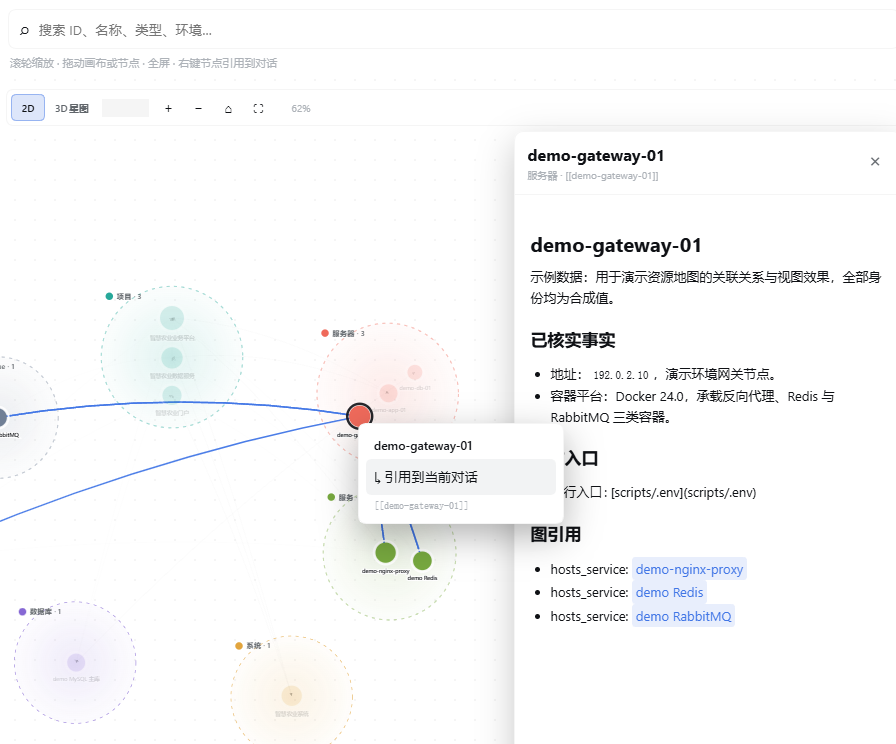
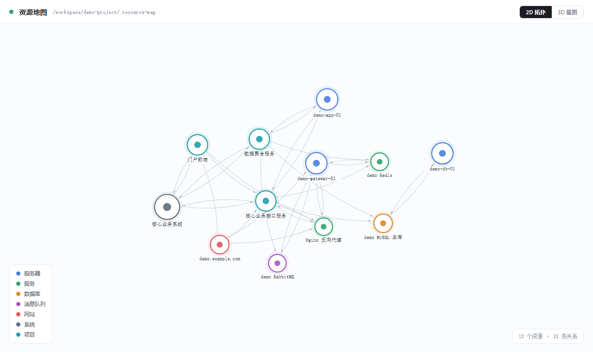

# Resource Map

**Give it one URL, and it traces the whole chain itself.**

Paste a page or API address and it walks from the domain entry all the way down to the host and the databases: DNS, reverse proxy, upstream, container, process, dependencies, logs — verified layer by layer, ending in an evidence-backed conclusion and the next step. You never have to tell it which machine, which service, or where the logs live.

> 中文: see [README.md](README.md).



## One URL, one complete chain

The expensive part of debugging production was never the fix — it is **working out what is actually behind this address**.

The usual path is asking people, digging through documents, guessing SSH targets, guessing log paths, trying one layer at a time. Resource Map builds those relations into a graph up front, so "what is behind this URL" becomes a fact you can look up:

```text
https://demo.example.com/orders        ← all you provide is this line
        │
        ├─ DNS      → 192.0.2.10
        ├─ Entry    → Nginx reverse proxy (80/443)
        ├─ Upstream → core API service :8080
        ├─ Host     → demo-app-01
        ├─ Deps     → MySQL primary / Redis / RabbitMQ
        └─ Evidence → per-layer config, log locations, recent change records
```

Every hop points at a real resource record carrying its entry points, credential location and operation history. The chain is not guessed — it is looked up, and **every conclusion lands on a specific file and a specific time**.

## Autonomous operations

Once the chain is explicit, daily operations stop depending on anyone's memory:

| Scenario | What you provide | What it does |
| --- | --- | --- |
| Incident triage | A URL or a symptom | Verifies layer by layer, pins the fault to a component and its code/config, reports a root cause or an explicit evidence gap |
| Impact assessment | A host or a service | Reverse-looks-up every project hosted on it and every system depending on it, producing a change-risk list |
| Change review | A release or config edit | Checks relations before and after, flags affected downstream |
| Handover | A system name | Expands the system aggregate with all components, entries and dependencies |
| Routine patrol | Nothing | Read-only checks through recorded entry points, writing drift into discovery logs |

Triage does not stop at "which host is down". It keeps walking into source, config, scheduling and dependencies until the chain closes — symptom → component → code → dependency → trigger — instead of parking on a likely guess. **Whatever cannot be verified is written down as a gap, never dressed up as a conclusion.**

## Why it can work autonomously

Because Resource Map is not a static document — it is **executable context**.

Each resource record carries facts (address, port, version), entry points (how to connect, where credentials live), relations (what it depends on, what depends on it), lessons (what went wrong before) and history (what was done on which day). Only with all of that can an Agent investigate on its own — otherwise it can only ask you more questions.

That is the difference from a document library: documents answer "what is it", Resource Map answers "**where do I get in, what do I check next, and what changed**".

## Two ways to use it

**In the conversation.** Just say "this address returns 502, look into it" — the Agent queries the graph, verifies layer by layer and reports back, instead of asking you to supply each piece.

**In the panel.** The side panel renders the graph with search, zoom, pan, per-node relation focus and a detail view. Right-click inserts a resource reference into the current draft.



## View modes: 2D topology / 3D star map

The default is a **2D clustered topology** — dense and good for reading structure. The **2D / 3D star map** toggle in the top-right corner switches to a three-dimensional star map:

- The star map is good for overall shape and clustering; drag to rotate, scroll to zoom, click to select.
- Your choice is remembered, so the next open renders the way you left it.
- The 3D renderer never loads unless you switch to it, and is released when you switch back or close the panel.

## Enabling

**Option one: just say so.** Tell the Agent "enable the resource map" and it initializes and starts working — no need to leave the conversation or start a new session.

**Option two: click the button.** A project that is not enabled shows an "Enable resource map" button in the side panel.

Enabling only affects the current project and never reads or modifies anything already in it. Enabling again is safe and only refreshes the index.

## What a resource looks like

Each resource is a directory holding one structured Markdown record plus its entry points, dedicated procedure and logs:

```text
<project>/.resource-map/
├── config.json          # allowed kinds, environments and statuses
├── resources/
│   └── <kind>/<environment>/<resource-id>/
│       ├── index.md     # main record: facts, relations, lessons, gaps
│       ├── scripts/.env # runtime entry points and credentials
│       ├── skill/       # resource-specific procedure and scripts
│       ├── references/  # reference material, config excerpts, DDL summaries
│       ├── discoveries/ # findings awaiting confirmation
│       └── oplog/       # operation records filed by date
├── skills/              # general methodology
├── runbooks/            # conventions and handbooks
└── tools/               # self-contained command line tool
```

Relations live in the `## 图引用` section of `index.md`, expressed as bidirectional links that may point at a specific piece of evidence:

```markdown
## 图引用

- routed_on_server: [[demo-gateway-01]]
- uses_nginx_service: [[demo-nginx-proxy]]
- serves_project: [[demo-portal-web]]
- serves_project: [[demo-core-api]]
```

**Only `index.md` becomes a graph node**; everything else is that resource's context. Resource IDs are globally unique, and relations always target an ID, never a path or a filename.

## Supported resource kinds

Two groups ship out of the box:

**Operations** — server, service, system, project, website, ops document, cloud provider, cloud account, cloud resource, Docker, Kubernetes, registry, Redis, message queue, queue channel, route, database, database namespace, database table.

**Narrative** — novel, volume, chapter, entity, event, action, timeline.

A timeline is an ordinary resource; time spans across resources are expressed as attributed relations and rendered as Gantt lanes beneath the graph.

Kinds are not fixed. When a domain is not covered, design a new kind first instead of forcing it into an existing one.

## Validation and maintenance

Run validation after editing records. It reports what is wrong — a relation pointing at a resource that does not exist, a missing required field, a format that breaks the convention, an operation log without a date prefix. **Format errors are never silently dropped**, which is what keeps the graph from drifting out of truth.

Validation can also be delegated to the Agent: have it check after editing and problems surface in the conversation.

## Operation records

Every time you touch a real system, leave a record in the resource directory:

```text
oplog/2026-11-10-disk-cleanup.md
```

The date prefix is mandatory and filed by the local date the operation happened; different dates must be separate files. That way a review lines up exactly with "what was done on which day, and on what evidence" — and it is what lets autonomous operations trust their own history.

## Safety boundaries

- **Read-only by default.** Resource Map itself never modifies the systems it describes.
- **Credentials stay local.** Entry points and credentials live in the resource's own directory, not centralized.
- **Changes need authorization.** Restart, deploy, config change and data writes require an explicit instruction and a written record.
- **Enabling leaves existing content alone.** A project's existing `resources/`, `catalog/`, skills and runbooks are never read or modified.

## Install

```bash
dsh plugin add github:qinyongliang/resource-map
```

`main` is the DSH plugin form; the `skill` branch is the non-DSH skill form of the same capability, for other Agents, editors and CI. Both share one implementation and one index, so they never diverge.

## Requirements

Node.js 22.5 or newer. Beyond that there are no runtime dependencies — no Python, no database service, nothing else to install.

## Display metadata

The plugin manager and settings page show the plugin's title, description and icon:

- `locale/zh.json` is the default Chinese description.
- `locale/en.json` is the optional English description.
- `icon.svg` is the plugin icon.

## License

MIT
