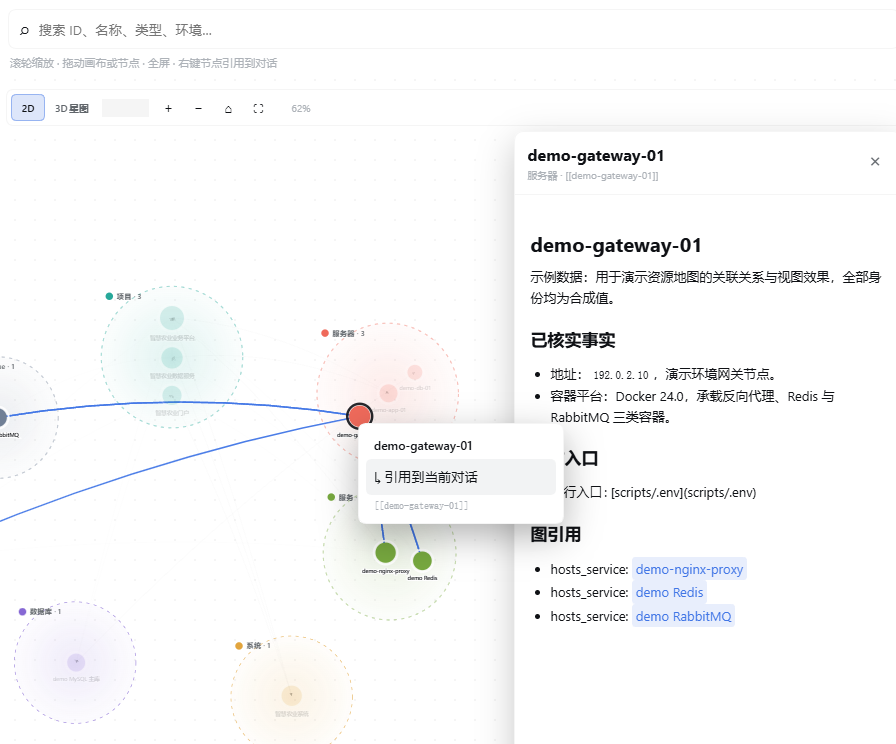
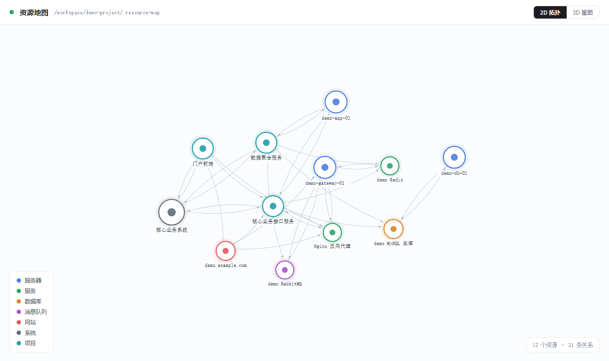

# 资源地图

**给它一个 URL，它自己把整条链路查完。**

贴一个页面地址或接口地址，它从域名入口一路走到宿主机和数据库：解析、反代、上游、容器、进程、依赖、日志，逐层核对，最后给出带证据的结论和下一步。中间不需要你告诉它机器在哪、服务叫什么、日志在哪个目录。

> English: see [README.en.md](README.en.md).



## 一个 URL，一条完整链路

排查线上问题最费时间的从来不是修复，而是**搞清楚这个地址背后到底有什么**。

传统做法是问人、翻文档、试 SSH、猜日志路径，一层层试。资源地图把这些关系预先建成图，于是"这个 URL 后面有什么"变成一个可以直接查的事实：

```text
https://demo.example.com/orders        ← 你只给这一行
        │
        ├─ DNS      → 192.0.2.10
        ├─ 入口      → Nginx 反向代理（80/443）
        ├─ 上游      → 核心业务接口服务 :8080
        ├─ 宿主      → demo-app-01
        ├─ 依赖      → MySQL 主库 / Redis / RabbitMQ
        └─ 证据      → 各层配置、日志位置、最近变更记录
```

每一跳都指向一个真实资源记录，带着它的操作入口、凭证位置和历史操作日志。所以链路不是猜出来的，是查出来的——**每个结论都能落到具体文件和具体时间**。

## 自动运维

链路清楚之后，日常运维就不再依赖某个人的记忆：

| 场景 | 你给什么 | 它做什么 |
| --- | --- | --- |
| 故障排查 | 一个 URL 或错误现象 | 沿链路逐层核验，定位到具体组件与代码/配置，输出根因或明确的证据缺口 |
| 影响面评估 | 一台机器、一个服务 | 反查所有承载其上的项目与依赖它的系统，给出重启/变更风险清单 |
| 变更核对 | 一次发布或配置改动 | 核对改动前后关系是否一致，标出受影响的下游 |
| 上手交接 | 一个系统名 | 展开系统聚合视图与其全部组件、入口、依赖 |
| 定期巡检 | 无需输入 | 按记录中的入口做只读核查，发现漂移写入发现日志 |

排查不止于"哪台机器挂了"。它会继续往下走到源码、配置、调度和依赖，把"现象 → 组件 → 代码 → 依赖 → 触发条件"这条链闭合，而不是停在一个高概率猜测上。**查不动的地方会明确写成缺口，不会伪装成结论。**

## 为什么能自动

因为资源地图不是一份静态文档，而是一份**可执行的上下文**。

每个资源记录里同时有：事实（地址、端口、版本）、入口（怎么连、凭证在哪）、关系（依赖谁、被谁依赖）、经验（踩过什么坑）、记录（哪天做了什么）。Agent 拿到这些，才可能自己完成排查——否则它只能反问你。

这也是它和普通文档库的区别：文档回答"是什么"，资源地图回答"**从哪进、往哪查、改了什么**"。

## 两种使用方式

**在对话里用。** 直接说"这个地址报 502，查一下"，Agent 会自己查图、逐层核验、给出结论，而不是让你逐个提供信息。

**在面板里看。** 会话侧面板提供关系图，支持搜索、缩放、平移、聚焦某个节点的关系、点开看详情。右键可以把某个资源的引用插入当前草稿。



## 视图模式：2D 拓扑 / 3D 星图

默认是 **2D 聚类拓扑**，信息密度高、适合梳理结构。右上角的 **2D / 3D星图** 按钮可以切换到三维星图：

- 星图适合看整体形状和聚类，支持拖动旋转、滚轮缩放、点击选中。
- 切换会记住你的选择，下次打开直接按上次的方式呈现。
- 不切到 3D 就永远不会加载它，切回 2D 或关闭面板即释放。

## 启用

**方式一：在对话里说一声。** 直接告诉 Agent「启用资源地图」，它会完成初始化并立刻开始工作——不需要你离开对话，也不需要重开会话。

**方式二：在面板里点按钮。** 未启用的项目在会话侧面板显示「启用资源图」，点击即可。

启用只影响当前项目，不会读取或改动项目里已有的任何内容。重复启用是安全的，只会刷新索引。

## 资源长什么样

每个资源是一个目录，里面是一份带结构化信息的 Markdown 记录，加上它的操作入口、专属流程和记录：

```text
<项目>/.resource-map/
├── config.json          # 本项目允许的资源类型、环境、状态
├── resources/
│   └── <类型>/<环境>/<资源ID>/
│       ├── index.md     # 主记录：事实、关系、经验、缺口
│       ├── scripts/.env # 运行入口与凭证
│       ├── skill/       # 该资源专属的操作流程与脚本
│       ├── references/  # 参考资料、配置摘录、DDL 摘要
│       ├── discoveries/ # 待确认的发现
│       └── oplog/       # 按日期归档的操作记录
├── skills/              # 通用方法论
├── runbooks/            # 规范与手册
└── tools/               # 自包含的命令行工具
```

资源之间的关系写在 `index.md` 的 `## 图引用` 段落，用双向链接表达，可以带锚点指向具体证据：

```markdown
## 图引用

- routed_on_server: [[demo-gateway-01]]
- uses_nginx_service: [[demo-nginx-proxy]]
- serves_project: [[demo-portal-web]]
- serves_project: [[demo-core-api]]
```

**只有 `index.md` 会成为图节点**，其它文件都是这个资源的上下文。资源 ID 全局唯一，关系永远指向 ID，不指向路径或文件名。

## 支持的资源类型

开箱即用的类型分两组：

**运维类** — 服务器、服务、系统、项目、网站、运维文档、云服务商、云账号、云资源、Docker、Kubernetes、镜像仓库、Redis、消息队列、队列通道、路由、数据库、数据库命名空间、数据库表。

**叙事类** — 小说、卷、章节、实体、事件、动作、时间线。

时间线是一种普通资源，跨资源的时间区间用带属性的关系表达，并在图底部渲染成甘特泳道。

类型不是固定的。遇到未覆盖的领域，可以先设计新的资源类型再落库，而不是硬塞进现有类型。

## 校验与维护

改完记录后运行校验，会告诉你哪里不对——关系指向了不存在的资源、必填字段缺失、格式不符合规范、操作日志没有日期前缀。**格式错误不会被静默忽略**，这保证了图不会悄悄失真。

校验也可以交给 Agent：让它改完顺手核对，问题会直接报在对话里。

## 操作记录

每次对真实系统动手，都在资源目录下留一条记录：

```text
oplog/2026-11-10-disk-cleanup.md
```

日期前缀是强制的，按操作发生的本地日期归档，不同日期必须分开。这样回溯时能精确对上"哪天做了什么、当时依据什么"——也是自动运维能信任自己历史的前提。

## 安全边界

- **默认只读。** 资源地图本身不修改任何被管理的系统。
- **凭证就地保存。** 运行入口和凭证放在对应资源目录，不集中到一处。
- **变更需授权。** 重启、发布、改配置、写数据等操作必须有明确指令并记录在案。
- **启用不动存量。** 项目原有的 `resources/`、`catalog/`、skill、runbook 都不会被读取或修改。

## 安装

```bash
dsh plugin add github:qinyongliang/resource-map
```

`main` 分支是 DSH 插件形态；`skill` 分支是同一套能力的非 DSH 技能形态，适合其它 Agent、编辑器和 CI 使用。两者共享同一份实现与同一个索引，不会产生分歧。

## 环境要求

Node.js 22.5 或更高版本。除此之外没有运行时依赖——不需要 Python，不需要数据库服务，不需要额外安装任何东西。

## 显示信息

插件管理器和设置页会展示插件的标题、说明和图标：

- `locale/zh.json` 是默认的中文说明。
- `locale/en.json` 是可选的英文说明。
- `icon.svg` 是插件图标。

## 许可证

MIT
